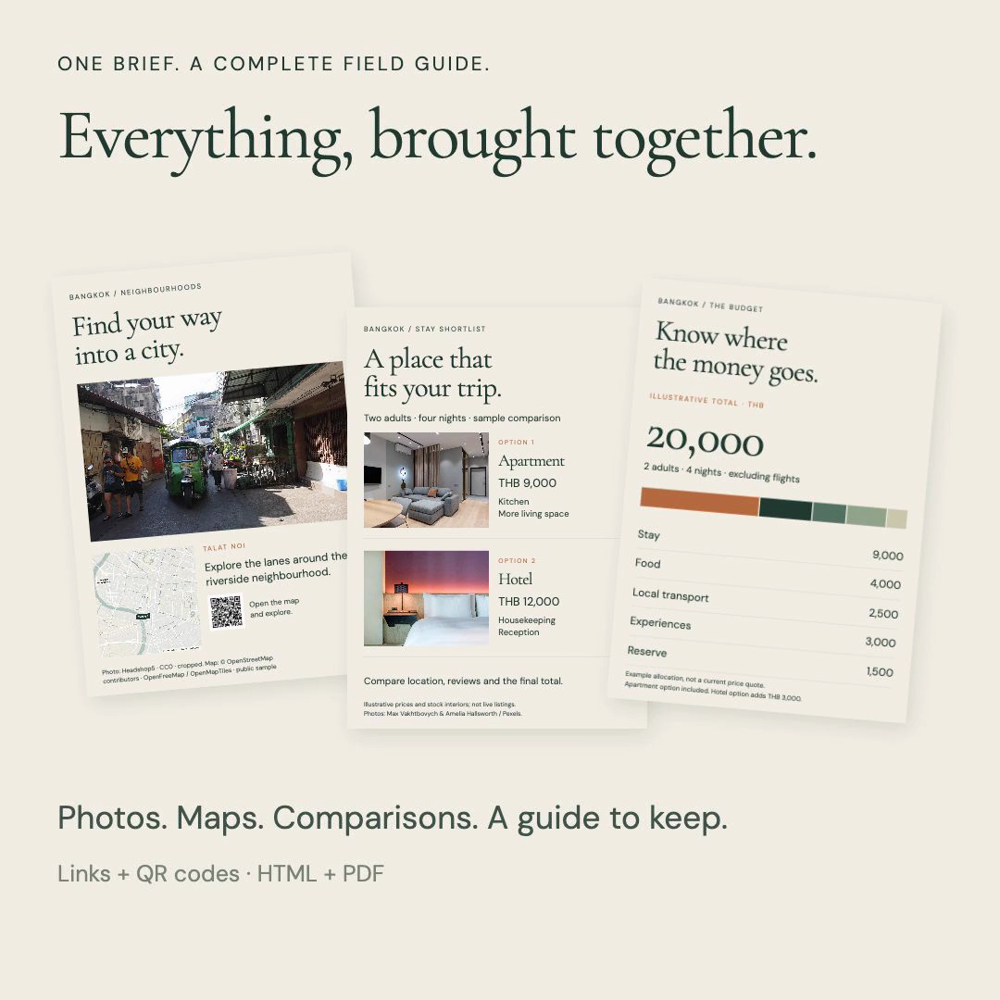

<p align="center"></p>

# Travel Fieldnotes

**Turn “plan my trip” into a guide worth keeping.**

A Codex skill for researched, illustrated travel guides: neighbourhood maps, thoughtful stays, comparable budgets, local stories and useful links. Designed to be read before a trip and used during it.

[Install](#install) · [Watch the 26-second demo](https://github.com/AmolDerickSoans/travel-fieldnotes/releases/download/v1.0.0/travel-fieldnotes-demo.mp4) · [Download the skill](https://github.com/AmolDerickSoans/travel-fieldnotes/releases/latest/download/travel-fieldnotes.zip)

<p align="center"></p>

## Install

In Codex, paste:

```text
$skill-installer install the skill at https://github.com/AmolDerickSoans/travel-fieldnotes/tree/main/skills/travel-fieldnotes
```

Or [download the skill ZIP](https://github.com/AmolDerickSoans/travel-fieldnotes/releases/latest/download/travel-fieldnotes.zip), unzip it, and place the `travel-fieldnotes` folder inside `~/.agents/skills/`. The final path should be `~/.agents/skills/travel-fieldnotes/SKILL.md`.

Codex detects new skills automatically; restart it if the skill does not appear. See the [official skills documentation](https://learn.chatgpt.com/docs/build-skills) for discovery and installation details.

## Give it your brief

```text
Use $travel-fieldnotes to plan a four-night city break.

We enjoy architecture, small museums and local food. We prefer relaxed
mornings and attractive, well-reviewed accommodation. Flights are booked.

Ask me for the dates, travellers, budget and any other details you need.
Research suitable stays, group each day geographically, compare the full
costs, and create an illustrated HTML and PDF guide with useful maps.
```

Dates, room configuration, fixed commitments, taste and budget basis matter more than a long prompt. Existing itineraries and reports work too: ask the skill to improve them while preserving decisions you like.

## What it helps you make

| Part of the guide | What the skill asks the agent to do |
| --- | --- |
| A workable itinerary | Check dates and closures, group places geographically, leave realistic transfer margins. |
| A considered stay shortlist | Inspect actual room photos, review patterns, neighbourhoods and the full price basis. |
| A clear budget | Compare the same party, nights and inclusions; separate quotes from estimates. |
| Maps and useful graphics | Use real geography, attribution, readable labels and honest travel-time estimates. |
| Stories worth reading | Explain particular places, objects and traditions with original, sourced writing. |
| A guide you can carry | Build readable HTML and/or PDF, with purposeful links, QR codes and print-safe maps. |
| An edited result | Check facts, arithmetic, links, page layout and the exported artifact. |

The skill supplies a workflow, editorial direction, optional CSS and a small Python audit helper. It is not a one-click generator or booking service. Results depend on the agent, available sources and rendering tools; review changing travel information before booking.

## Requirements

- Codex with local skills support, browsing/search and file access.
- A toolchain capable of producing the requested format. PDF export, QR generation and map rendering use whatever suitable tools are available in the host environment.
- Python 3.10+ only if using the optional audit helper. That helper uses the standard library and makes no network calls.

There is no API key requirement built into the skill. Optional external map or image services may have their own requirements. Other Agent Skills-compatible hosts may be able to load the instructions, but this release is documented and tested for Codex.

## Public samples

[Map page](docs/media/sample-map.png) · [Stay comparison](docs/media/sample-stays.png) · [Budget page](docs/media/sample-budget.png)

These pages were reconstructed for a public demonstration. They are not a real traveller’s itinerary. The neighbourhood map and street photograph depict public places; the stay images are licensed stock interiors. Prices and accommodation attributes are illustrative, not live listings or verified availability. No private reports, bookings, travel dates or personal schedules are included.

Photograph, map, font and sound credits are in [CREDITS.md](docs/CREDITS.md). The demo condenses the workflow; it is not a recording of a model response or a benchmark against another product.

## Optional audit helper

Run from the repository root, substituting your report path and actual review date:

```sh
python3 skills/travel-fieldnotes/scripts/audit_report.py /path/to/guide.html --as-of YYYY-MM-DD
```

Add `--manifest /path/to/manifest.json` to check declared nights and budget arithmetic. The [synthetic example manifest](skills/travel-fieldnotes/references/example-manifest.json) documents the supported fields.

The helper checks local references, fragments, duplicate IDs, declared arithmetic and dates. It does **not** validate live prices, source accuracy, map geometry, QR readability or privacy.

Run the included behavioral checks:

```sh
python3 -m unittest discover -s skills/travel-fieldnotes/tests -v
```

## Contributing

Small improvements backed by a concrete failure or a better outcome are welcome. Use synthetic examples in issues and pull requests; omit booking references, personal schedules, private addresses and traveller details.

## Licence

The skill, helper and original documentation are [MIT-licensed](LICENSE). Photography, maps, fonts and composed promotional media retain the terms described in [CREDITS.md](docs/CREDITS.md). No travel provider, photographer or AI company endorses the project.
